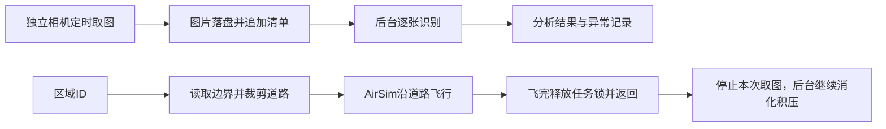

# 沿道路搜索、拍照与后台识别

入口是 `UAV/API/search.py` 的 `search()`。它沿指定区域的道路巡逻，使用独立向下相机定时保存图片，由视觉模型分析。飞行不依赖图片识别是否完成，飞完即返回 `None` 并释放无人机任务锁，可以接下一次飞行。

## 调用

在项目根目录安装依赖：

```powershell
python -m pip install -r UAV/requirements.txt
python -m pip install -r llm/requirements.txt
```

```python
from UAV.API import search

search(
    "UAV_01",
    {"zone_id": "F-SCHOOL-1", "scope": "nearby", "buffer_m": 50},
    flight_height=40,      # 相对起飞地面高度，整段固定高度
    flight_speed=5,        # 米/秒上限，转弯及短路段会减速
    capture_interval=3,   # 秒；取图本身有耗时，不承诺精确等间隔
    output_dir="UAV/search_results",
)
# 到这里：飞行已结束，无人机可以执行下一次任务，旧图片可能仍在后台识别。
```

40米只是调用示例，必须通过沿途已知建筑的净空检查。`target` 直接使用自然语言规划生成的 `SearchArea.target`，不会把学校替换成居住区。省略 `scope` 时巡逻区域内部道路；`nearby` 巡逻边界外环带，距离省略时默认50米。

也可直接运行（会实际飞行并调用模型）：

```powershell
python -B -X utf8 UAV/API/search.py F-SCHOOL-1 --nearby 50 --height 40 --speed 5 --interval 3
```

可选参数还包括 `stop_event=threading.Event()`（请求取消）、`camera="bottom_center"`（独立向下相机）、`analyze_image=自定义函数`。自定义函数返回 `status` 与 `description`，并须在后台工作完成前保持其资源可用。默认分析器由程序自动关闭，不需自己管理SDK连接。

## 每一部分如何工作



1. 只读 `Map/functional_zones.json` 的真实多边形，内部范围或边界外缓冲环带均支持内洞和MultiPolygon。
2. 从 `Map/road_network.json` 选择机动车道与合法连接边，按范围裁剪。同一道路、同一section的多条车道只选一条作为必巡路线，选择本次范围内有效长度最长的真实车道；不按空间距离合并不同道路。路口连接边仅用于通行，不要求逐条巡查。完整通行拓扑保留，零长度连接仍有效，不把没有连接的平面交叉点当路口。
3. 接入道路，按拓扑距离生成完整覆盖方案，再调整巡查块的方向、顺序和插入位置，用真实路网的最短连接减少重复掉头与绕行。保留全部必巡路段，只有不更长的完整路线才替换原方案；超过200个巡查块时保留原方案以限制规划耗时。连接道路可以在范围外；断路、无路和已知建筑高度冲突会在飞行前拒绝。
4. 沿显式折线调用AirSim飞行控制，核对实际位置后才记录该段完成。取消、碰撞和飞行错误才进入停止控制；识别超时或识别积压不触发悬停。
5. 相机使用另一条AirSim连接，图片先写 `.part` 再原子改名 `.jpg`，随后追加 `frames.jsonl`。每张图记录时间、观察位置、相机姿态与路段。
6. 后台只从磁盘清单顺序读取下一张，不维护图片内存队列，也不等待飞行检查点放行。结果追加到 `analyses.jsonl`，异常追加到 `events.jsonl`。

路线目前按道路代表车道巡查，而非逐车道覆盖；不修改原地图，也不生成脱离路网的直线捷径。独立编号的道路及路口内部弯道仍保留为目标，连接与巡查允许重复经过，不承诺最短或图像视野完整覆盖。学校50米范围可能规划数公里，不能把真实巡航时间等同于几秒的自然语言规划。尚未实现动态避障、多机冲突调度或视觉覆盖率证明。

## 图片处理跟不上飞行时怎么办

**让图片在磁盘上排队，飞行和拍照继续；飞完也不等待识别。**

例如每3秒拍一张，一分钟产生约20张。如果模型平均23.7秒处理一张，单个识别线程每分钟只能完成约2.5张，积压会增长约17.5张/分钟。现在不会为这个积压悬停、降低飞行速度、暂停拍照或静默丢图；线程会在飞行结束后继续处理。

这解决的是飞行被阻塞的问题，不能让模型凭空具备实时吞吐量。保留全部图片意味着告警可能延迟，任务越长积压越多，磁盘也需要相应空间。若未来要求每张图实时识别，需要更快的视觉模型或足够并发；抽帧则会改变逐张识别的要求，本版不擅自这样做。

没有“飞完等120秒就将剩余图片全部判失败”的旧规则。实际请求最多尝试两次；两次都失败只把这一张标为 `failed`，继续下一张，绝不当作 `normal`。

后台线程会保持Python进程存活。因此直接运行脚本时，终端可能在飞行结束后仍未退出，表示图片还在处理；`search()`本身已返回，任务锁也已释放。强制退出会停止后台处理，磁盘图片与已写入的清单保留。

停止拍照的旧任务可以只续跑识别，不再飞行：

```powershell
python -B -X utf8 -m UAV.utils.search_analysis "UAV/search_results/日期/任务ID/UAV_01"
# 同时重试之前识别失败的图片：
python -B -X utf8 -m UAV.utils.search_analysis "UAV/search_results/日期/任务ID/UAV_01" --retry-failed
```

续跑跳过已成功的图片，默认也跳过已失败的图片；只有 `--retry-failed` 会重试失败项。目录有系统文件锁，不能同时运行两个识别器重复处理同一任务。续跑只分析图片，不会停止或控制无人机；若飞行进程异常退出且没有最终记录，飞行结果记为未知，不冒充航路完成。

## 当前模型大概多快

当前沿用 `llm/.env` 的 **qwen3.8-flash**，温度0、minimal思考，发送真实JPEG字节与简短元信息，图片detail为high。可用 `OPENAI_VISION_MODEL` 单独指定视觉模型，本次没有改 `.env`。

3张真实1600×900巡查图实测如下，均一次成功：

| 图片 | 单次请求耗时 |
| --- | ---: |
| 000002 | 28.047秒 |
| 000011 | 22.500秒 |
| 000036 | 20.500秒 |
| 平均 | **23.682秒/张** |

这是包含上传、网络和模型返回的小样本，不是长期性能保证，也不包含等前面图片的排队时间。SDK配置的25秒是网络阶段超时，不是严格的请求总时限，所以成功请求可能超过25秒。重试会进一步增加单张总耗时。

`analyses.jsonl`分别记录 `queue_wait_seconds`（拍摄至开始处理）、`analysis_seconds`（本张处理总耗时，含重试）、`attempt_seconds`（各次调用耗时）。本次测速复用了旧图，因此测速记录中的拍摄至处理间隔包含旧图存放时间，不能用它判断当前队列延迟。历史测速产物已清理；实际处理耗时可从每次任务的 `analyses.jsonl` 查看。

## 结果在哪里、怎么看

每次调用创建 `UAV/search_results/日期时间/任务ID/无人机/`：

| 文件 | 内容 |
| --- | --- |
| plan.json | 范围、目标道路和巡查顺序 |
| images/*.jpg | 已保存的巡查图片 |
| frames.jsonl | 每张图的时间、观察位置和相机信息；也是持久化待处理清单 |
| analyses.jsonl | 每张图的识别结果或失败记录、请求耗时 |
| events.jsonl | 异常与拍照错误，有事件时生成 |
| progress.jsonl | 实际路点、已完成道路 |
| summary.json | 飞行状态、识别状态和统计，原子替换以避免读到半份报告 |

飞行中 `status=running`；飞完但仍有积压时是 `analysis_pending`。`flight_status`与`flight_completed`单独表示飞行结果，识别结束后 `analysis_status=completed/incomplete`，总状态为 `completed/incomplete`；取消和飞行错误保留 `cancelled/failed`，不会被后续识别成功覆盖。`analysis_pending` 是待处理数，不是失败数。报告在飞行结束及识别结束时写快照，逐张进度查看 `analyses.jsonl`。

`search()`只同步抛出飞行/拍照阶段的错误；函数返回后发生的识别错误写入报告，不会追溯抛异常或控制无人机。异常规则在 `llm/prompts/search_vision.txt`，仅检查三类：需要紧急医疗救援的病人、持刀歹徒（以可见持刀行为描述疑似危险人员）、可疑（超速）车辆。输出仍仅含 `status(normal/abnormal/uncertain)` 与 `description`，不额外报告烟火、道路阻塞等类别。单张图片不能确认病情、犯罪身份或车速；疑似异常须给出可见证据，证据不足返回uncertain，不能编造车速。目前只记录告警，不自动追踪、复拍或处置。观察位置不是异常物体的精确位置，`uncertain`也不代表正常。提示词在分析器创建时加载，修改后需新建分析器或重新启动识别任务；不会改变已经进行中的请求。

## 代码职责

| 文件 | 职责 |
| --- | --- |
| API/search.py | 调用入口、飞行主流程、任务锁释放 |
| utils/plan_search_path.py | 地图裁剪、道路巡查规划、已知建筑净空检查 |
| utils/flight_control.py | 与fly_to_point共用停止/稳定控制，执行显式搜索路径 |
| utils/search_capture.py | 独立相机、定时保存图片及清单 |
| utils/search_analysis.py | 读取磁盘积压、重试、报告、断点续跑；完全不接触AirSim |
| llm/vision.py | 现有OpenAI SDK的图片请求与结果校验 |
| llm/prompts/search_vision.txt | 可替换的视觉异常提示词 |

删除了队列满则悬停、拍照信号量、内存待处理队列、120秒统一截断、重复的最终悬停和无用途的hold包装。保留fly_to_point原签名与行为；不修改地图、网页或环境配置。


图片输入格式参考[OpenAI官方图片输入文档](https://developers.openai.com/api/docs/guides/images-vision)。
